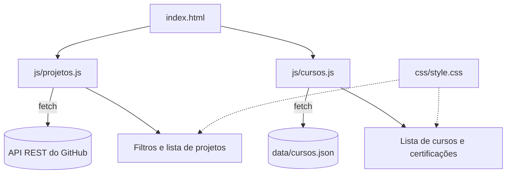

# Portfólio — Vítor Gato

Portfólio pessoal de **Vítor Gato**, estudante de Engenharia da Computação na Universidade do Estado de Minas Gerais (UEMG). O projeto apresenta minha formação, habilidades, projetos acadêmicos e pessoais, cursos, certificações e informações de contato.

O site possui carregamento dinâmico de conteúdo: os projetos são obtidos diretamente da API pública do GitHub, enquanto os cursos e certificações são armazenados em um arquivo JSON.

🌐 **Acesse o portfólio:** [vitorantonio-gn.github.io](https://vitorantonio-gn.github.io/)


---

## Sumário

- [Funcionalidades](#funcionalidades)
- [Tecnologias](#tecnologias)
- [Estrutura do projeto](#estrutura-do-projeto)
- [Como executar](#como-executar)
- [Como funciona](#como-funciona)
- [Documentação](#documentação)
- [Personalização](#personalização)
- [Acessibilidade e SEO](#acessibilidade-e-seo)
- [Limitações conhecidas](#limitações-conhecidas)
- [Contato](#contato)

---

## Funcionalidades

- **Apresentação pessoal:** seção inicial com informações sobre minha formação, localização e links de acesso.
- **Identidade visual:** ilustração decorativa de um computador construída com HTML e CSS, acompanhada de um fundo SVG.
- **Navegação:** cabeçalho com posicionamento sticky e navegação por âncoras com rolagem suave.
- **Sobre mim:** apresentação da minha formação acadêmica e dos meus interesses na área de tecnologia.
- **Habilidades:** exibição das principais linguagens e ferramentas que utilizo.
- **Projetos dinâmicos:** consulta aos repositórios públicos do GitHub, com ordenação por data de criação e filtros por linguagem de programação.
- **Cursos e certificações:** carregamento dos dados a partir de um arquivo JSON, com ordenação por data de conclusão e links para credenciais disponíveis.
- **Layout responsivo:** adaptação para diferentes tamanhos de tela por meio de três pontos de quebra.
- **Tratamento de estados:** mensagens de carregamento, erros e exibição de listas vazias.
- **Movimento reduzido:** respeito à preferência `prefers-reduced-motion` do sistema operacional.

## Tecnologias

| Tecnologia | Aplicação |
|---|---|
| HTML5 | Estrutura semântica e organização do conteúdo |
| CSS3 | Estilização, Grid, Flexbox, variáveis, transições, animações e responsividade |
| JavaScript (ES6+) | Manipulação do DOM, requisições com `fetch` e operações assíncronas com `async/await` |
| JSON | Armazenamento dos cursos e certificações |
| API REST do GitHub | Consulta aos repositórios públicos |
| Google Fonts | Carregamento das fontes Inter e Space Grotesk |
| Git e GitHub | Versionamento e hospedagem do código |
| GitHub Pages | Publicação do portfólio |

O projeto utiliza HTML, CSS e JavaScript puros, sem frameworks, bibliotecas JavaScript ou ferramentas de build.

## Estrutura do projeto

A organização dos arquivos segue a seguinte estrutura:

```text
VitorAntonio-GN.github.io/
│
├── assets/
│   └── prequel.svg
│
├── css/
│   └── style.css
│
├── data/
│   └── cursos.json
│
├── docs/
│   ├── css.md
│   ├── dados.md
│   ├── js.md
│   └── reflexao.md
│
├── js/
│   ├── cursos.js
│   └── projetos.js
│
├── index.html
└── README.md
```

### Descrição dos diretórios

- `assets/`: contém os recursos gráficos utilizados no site.
- `css/`: contém a folha de estilos principal.
- `data/`: armazena os dados dos cursos e certificações em formato JSON.
- `docs/`: reúne a documentação técnica e a reflexão sobre o desenvolvimento.
- `js/`: contém os scripts responsáveis pelo carregamento e pela renderização dos conteúdos dinâmicos.

## Como executar

O projeto não exige instalação de dependências, gerenciadores de pacotes ou ferramentas de compilação.

**1. Clone o repositório:**

```bash
git clone https://github.com/VitorAntonio-GN/VitorAntonio-GN.github.io.git
```

**2. Acesse a pasta do projeto:**

```bash
cd VitorAntonio-GN.github.io
```

**3. Inicie um servidor HTTP local:**

```bash
python -m http.server 8000
```

**4. Abra o endereço no navegador:**

```text
http://localhost:8000
```

É necessário utilizar um servidor HTTP local para que o JavaScript consiga carregar corretamente o arquivo `data/cursos.json` por meio de `fetch`. Abrir o `index.html` diretamente pelo sistema de arquivos pode impedir essa requisição.

## Como funciona

O projeto utiliza o HTML como estrutura principal, o CSS para apresentação visual e o JavaScript para buscar, processar e exibir os dados dinamicamente.

### Fluxo de funcionamento



### Projetos

O arquivo `js/projetos.js` realiza uma requisição à API REST do GitHub para obter os repositórios públicos do usuário.

Após receber os dados, o script:

1. Verifica se a requisição foi concluída corretamente.
2. Organiza os dados relevantes, como nome, descrição, linguagem e data de criação.
3. Ordena os projetos do mais recente para o mais antigo.
4. Identifica as linguagens de programação disponíveis.
5. Cria filtros dinâmicos para permitir a seleção de uma linguagem.
6. Constrói os elementos HTML correspondentes aos projetos e os adiciona à página.

### Cursos e certificações

O arquivo `js/cursos.js` realiza a leitura de `data/cursos.json`.

Após obter os dados, o script:

1. Verifica a validade da resposta e a estrutura do JSON.
2. Organiza as informações de cada curso.
3. Converte e formata as datas de conclusão.
4. Ordena os cursos do mais recente para o mais antigo.
5. Cria os elementos HTML para apresentar os cursos.
6. Valida os endereços das credenciais antes de criar os links correspondentes.

### Estilização

O arquivo `css/style.css` centraliza a apresentação visual do portfólio, definindo cores, tipografia, espaçamentos, layouts, componentes e regras de responsividade.

Os elementos criados dinamicamente pelo JavaScript utilizam as mesmas classes CSS definidas para os componentes da página.

## Documentação

A documentação técnica complementar está organizada em arquivos específicos dentro de `docs/`.

| Documento | Conteúdo |
|---|---|
| [CSS](docs/css.md) | Organização da folha de estilos, variáveis, seletores, componentes e responsividade |
| [JavaScript](docs/js.md) | Estrutura dos scripts, funções, estados, requisições e manipulação do DOM |
| [Dados](docs/dados.md) | Estrutura do arquivo JSON, propriedades e gerenciamento dos cursos e certificações |
| [Reflexão](docs/reflexao.md) | Aprendizados, dificuldades encontradas e conhecimentos desenvolvidos durante o projeto |

## Personalização

As principais informações e características visuais podem ser alteradas nos seguintes arquivos:

| O que personalizar | Onde modificar |
|---|---|
| Usuário do GitHub utilizado na consulta | Constante `API_URL` em `js/projetos.js` |
| Cores e fontes | Variáveis CSS no início de `css/style.css` |
| Textos, informações pessoais e links | `index.html` |
| Habilidades | Lista `.skills-list` em `index.html` |
| Cursos e certificações | `data/cursos.json` |
| Imagem de fundo da apresentação | `assets/prequel.svg` |
| Opacidade do fundo da apresentação | Regra `.hero__background` em `css/style.css` |

## Acessibilidade e SEO

O desenvolvimento considera práticas de acessibilidade e otimização para mecanismos de busca:

- Uso de elementos HTML semânticos, como `header`, `nav`, `main`, `section`, `address` e `footer`.
- Identificação do idioma da página por meio de `lang="pt-BR"`.
- Associação entre seções e títulos utilizando `aria-labelledby`.
- Identificação de mensagens dinâmicas com `role="status"`.
- Ocultação de elementos exclusivamente decorativos com `aria-hidden="true"`.
- Indicadores de foco visíveis por meio de `:focus-visible`.
- Suporte à preferência de movimento reduzido com `prefers-reduced-motion`.
- Meta tags para descrição, autoria e compartilhamento de conteúdo com Open Graph.

## Limitações conhecidas

- **Limite da API do GitHub:** requisições não autenticadas possuem limite de 60 solicitações por hora por endereço IP. Caso esse limite seja excedido, a consulta pode falhar e a seção de projetos apresenta uma mensagem de erro.
- **Quantidade de repositórios:** a consulta utiliza `per_page=100`, mas não implementa paginação adicional. Portanto, considera no máximo os 100 repositórios retornados pela requisição.
- **Credenciais:** o campo `credencial` é armazenado no JSON, mas atualmente não é exibido diretamente na página. Quando existe uma URL válida em `urlCredencial`, é disponibilizado um link para acessar a credencial.
- **Fontes externas:** as fontes Inter e Space Grotesk são carregadas pelo Google Fonts e dependem de conexão com a internet para serem obtidas externamente.

Mais informações sobre os limites da API podem ser encontradas na [documentação oficial do GitHub](https://docs.github.com/en/rest/using-the-rest-api/rate-limits-for-the-rest-api).

## Contato

Estou aberto a oportunidades, projetos e conexões na área de tecnologia.

- **E-mail:** [vitorgatoneto@gmail.com](mailto:vitorgatoneto@gmail.com)
- **GitHub:** [VitorAntonio-GN](https://github.com/VitorAntonio-GN)
- **LinkedIn:** [linkedin.com/in/vitorgato](https://www.linkedin.com/in/vitorgato)

---

© 2026 Vítor Gato. Todos os direitos reservados.